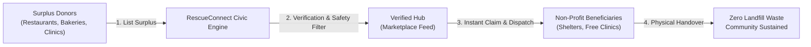
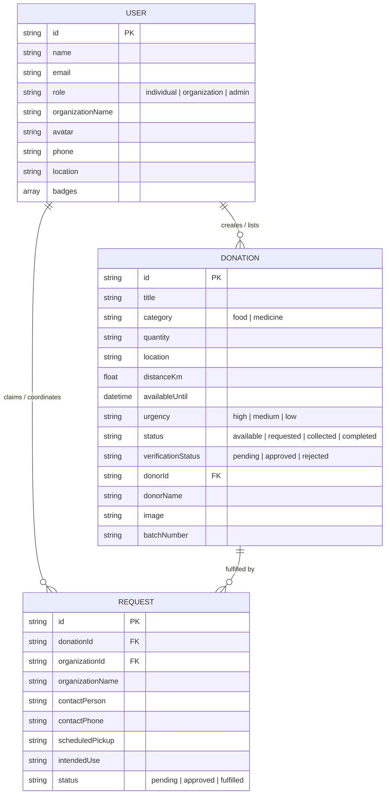

# 🏛️ RescueConnect — Master Project Reference & Architecture Dossier

> **Platform Mission:** *"Don't Waste What Someone Needs."*  
> **Domain:** Civic Tech / Zero-Waste Food Redistribution & Verified Community Medicine Logistics  
> **Version:** 2.0.0 (Spatial Architectural Beige Edition)  
> **Target Audience:** Hackathons, Project Expos, Developers, Civic Organizations, and Stakeholders  

---

## 📑 Table of Contents
1. [Executive Summary & Problem Statement](#1-executive-summary--problem-statement)
2. [Stakeholders & User Personas](#2-stakeholders--user-personas)
3. [Design System & Spatial Aesthetic Philosophy](#3-design-system--spatial-aesthetic-philosophy)
   - [Why the Warm Stone / Alabaster Beige Palette?](#why-the-warm-stone--alabaster-beige-palette)
   - [Typography System: Editorial Dignity](#typography-system-editorial-dignity)
   - [Signature Spatial Components](#signature-spatial-components)
4. [Technology Stack & Architectural Rationale](#4-technology-stack--architectural-rationale)
   - [Why Each Technology Was Chosen](#why-each-technology-was-chosen)
5. [End-to-End System Walkthrough (All 14 Modules)](#5-end-to-end-system-walkthrough)
6. [Data Architecture & Reactive State Model](#6-data-architecture--reactive-state-model)
7. [Safety, Hygiene & Medical Compliance Protocols](#7-safety-hygiene--medical-compliance-protocols)
8. [Expo Pitch Guide & 3-Minute Live Demo Script](#8-expo-pitch-guide--3-minute-live-demo-script)
9. [Future Roadmap & Scale Strategy](#9-future-roadmap--scale-strategy)

---

## 1. Executive Summary & Problem Statement

### The Twin Crisis
Every year, millions of tons of edible, safe, and nutritious food are sent to municipal landfills by commercial restaurants, event caterers, bakeries, and households. Concurrently, millions of unopened, unexpired over-the-counter (OTC) medicines and emergency care kits expire unused on household and pharmacy shelves.

Meanwhile, local homeless shelters, community kitchens, refugee outreach posts, and charitable free clinics face constant supply shortages, relying on sporadic, uncoordinated hand-outs.

### The RescueConnect Solution
**RescueConnect** is an end-to-end civic marketplace that bridges surplus resource holders (hotels, bakeries, restaurants, clinics, citizens) directly with verified community shelters and frontline healthcare units in real time.



---

## 2. Stakeholders & User Personas

| Role | Target Users | Core Activities on RescueConnect |
| :--- | :--- | :--- |
| **Individual Donors** | Citizens, Home Cooks, Neighborhood Organizers | Lists home surplus, event leftovers, unopened OTC health packs; tracks personal carbon & meal diversion stats. |
| **Commercial Donors** | Hotels, Event Caterers, Bakeries, Supermarkets, Pharmacies | Bulk listings (banquet trays, 40+ loaves, medicine strips), automated pickup instructions, tax receipt generation. |
| **Organizations (NGOs)** | Homeless Shelters, Food Pantries, Community Clinics | Real-time browsing, urgent distance filtering, claiming resources, logistics scheduling, beneficiary allocation. |
| **Civic Administrators** | Municipal Health Officers, Platform Pharmacists | Batch verification, sanitary review, safety disputes, organization accreditation, compliance auditing. |

---

## 3. Design System & Spatial Aesthetic Philosophy

### Why the Warm Stone / Alabaster Beige Palette?

```
┌────────────────────────────────────────────────────────────────────────┐
│  Ambient Stone Canvas: #e8e3dc   │  Spatial Frame Beige: #f4efe8       │
│  Surface Card Beige:   #f0eae1   │  Deep Charcoal Ink:   #1c1917       │
│  Contrast Capsule:     #201f1e   │  Emerald Accent:      #059669       │
└────────────────────────────────────────────────────────────────────────┘
```

#### The Rationale:
1. **Dignity Over Clinical Austerity:** Most charity and welfare websites rely on stark, sterile pure white backgrounds (`#ffffff`) or generic flat corporate blues. Pure white creates eye fatigue, feels cold, and lacks warmth. RescueConnect employs **warm natural limestone, ivory, and beige (`#e8e3dc` and `#f4efe8`)**, evoking human warmth, environmental harmony, and organic care.
2. **Architectural Spatial Elegance:** Inspired by world-class architectural portfolio design (such as luxury pavilion villas with infinity water reflection), every module is presented as a floating spatial element with soft organic drop shadows (`rgba(40, 30, 20, 0.06)`).
3. **High-Contrast Readability:** All typography uses deep charcoal ink (`#1c1917` and `#201f1e`) rather than washed-out grays, guaranteeing WCAG AAA contrast ratios against the beige backdrop.

### Typography System: Editorial Dignity

- **Primary Editorial Display Font:** `Cormorant Garamond` (Google Serif)  
  *Why:* Applied to master headings (e.g., *"Spaces That Sustain Life"*, *"Champions of Surplus & Care"*). It brings classical editorial majesty and elegance to community welfare, conveying that feeding the hungry and healing the sick is an endeavor of the highest civic nobility.
- **Interface & UI Body Font:** `Plus Jakarta Sans` (Geometric Sans)  
  *Why:* Ultra-clean, modern geometric curves with tall x-height, ensuring effortless readability for quantities, timestamps, locations, and form inputs.
- **Technical & Telemetry Monospace Font:** `JetBrains Mono`  
  *Why:* Used for resource IDs, GPS coordinates, countdown clocks, and status codes (`01 / 06`, `RC-1024`, `99.8% Sync`).

### Signature Spatial Components

1. **Left Floating Capsule Dock (`LeftDock.jsx`):**
   - Vertical capsule dock pinned to the hero frame.
   - Hosts the dark active home circle, marketplace shortcuts, user profile ring, and 3D toggle pill.
2. **Top Fixed Capsule Navbar (`Navbar.jsx`):**
   - Pinned fixed navigation bar with frosted warm stone backdrop (`bg-[#e8e3dc]/95 backdrop-blur-xl`).
   - Integrated **1-Click Redistribution Console** allowing instant live persona switching (`Individual Donor`, `NGO / Org`, `Civic Admin`).
   - Signature dark capsule CTA button with white circular angled arrow badge (`Donate Surplus ↗`).
3. **Bottom Bento Deck (`Home.jsx`):**
   - **Featured Rescue Card:** Working real-time carousel with live numerical pagination (`01 / 06`), volunteer avatar bubbles (`+18`), interactive dash indicators (`— · · ·`), and tactile `←` `→` sliders.
   - **Civic Impact Pill:** Frosted alabaster pill displaying verified milestones (`1,240+ Meals`, `320+ Donors`, `85+ Shelters`).
   - **Dark Contrast Callout Card:** Luxury `#201f1e` card driving instant onboarding.
4. **Interactive 3D WebGL Canvas (`RescueCanvas3D.jsx`):**
   - Custom Three.js studio daylight setup.
   - Supports 3 real-time WebGL modes: **Holographic Redistribution Network**, **3D Food Relief Crate**, and **3D Medicine Capsule**.
   - Features 360° mouse-drag orbit and inertia gyro-tilt.

---

## 4. Technology Stack & Architectural Rationale

| Layer | Technology | Version | Why It Was Chosen |
| :--- | :--- | :--- | :--- |
| **Framework** | **React** | `19.2.0` | Declarative UI, modern concurrent features, fast component tree reconciliation. |
| **Build Tool** | **Vite** | `8.2.2` | Sub-second cold starts, lightning-fast Hot Module Replacement (HMR), optimized production bundling. |
| **Styling** | **Tailwind CSS** | `4.0.0` | Zero-runtime CSS generation, arbitrary color values (`bg-[#f4efe8]`), effortless responsive modifiers. |
| **3D Graphics** | **Three.js** | `0.182.0` | Industry-standard WebGL rendering engine. Enables custom lighting, geometries, and interactive orbital controls without external heavy 3D asset downloads. |
| **Routing** | **React Router DOM** | `7.3.0` | Client-side SPA routing, dynamic route parameters (`/resource/:id`), protected role-based route wrappers. |
| **Iconography** | **Lucide React** | `1.16.0` | Feather-light, consistent, crisp vector SVG icons perfectly matched to the spatial theme. |
| **Micro-Delight** | **Canvas Confetti** | `1.9.4` | Physics-based particle celebration on successful donation submission and resource claiming. |
| **Persistence** | **LocalStorage Engine** | Native | Zero-dependency, 100% offline-ready client-side database with customized window event bus (`rc_storage_changed`). |

---

## 5. End-to-End System Walkthrough

### 1. Spatial Hero & Home (`/`)
- **Visual:** Ambient villa photography backdrop + Three.js holographic node canvas + Bottom Bento Deck.
- **Functionality:** Real-time carousel cycling through 6 verified surplus resources, category cards with 3D perspective mouse tracking, and 4-step workflow explainer.

### 2. Community Resource Marketplace (`/browse`)
- **Visual:** Warm beige container with search toolbar, urgency chips, and multi-parameter filters.
- **Features:**
  - Real-time text search across resource title, donor name, description, and location.
  - Category filtering: `All`, `Food Rescue 🍱`, `Medicine Donation 💊`.
  - Proximity filter: simulated distance radius (`< 2 km`, `< 5 km`, `< 10 km`).
  - Urgency level sorting (`High`, `Medium`, `Low`).
  - Direct claim modal trigger with instant confetti feedback.

### 3. Resource Technical Dossier (`/resource/:id`)
- **Features:**
  - High-res photo gallery with category and urgency badges.
  - Category-specific technical data:
    - *Food:* Food type, sanitary packaging, prepared timestamp, expiry deadline.
    - *Medicine:* Chemical/OTC form, manufacturer lot/batch number, storage requirements, verified expiry date.
  - **Civic Radar Telemetry Card (`SimulatedMap.jsx`):** Animated radar sweeping cone, geodesic distance ring, real-time donor hub blip, en-route shelter van ETA indicator.
  - Donor credentials card with verified trust rating (e.g. `★ 4.98`).

### 4. Food Rescue Submission Portal (`/donate-food`)
- **Features:**
  - Dynamic listing form with preset quick-select buttons for food types (*Prepared meals, Bakery, Grocery, Produce*).
  - Expiry countdown calculator.
  - **Live Real-time Card Preview (`LivePreviewCard.jsx`):** Interactive card preview that updates instantaneously as the donor types their title, quantity, and location.
  - Preset image selector + custom image upload support.

### 5. Verified Medicine Donation Portal (`/donate-medicine`)
- **Features:**
  - Prominent safety protocol banner with eligibility checkboxes.
  - Strict input validations: Minimum 30-day shelf life remaining, factory seal confirmation, batch tracking number.
  - Instant dispatch to Admin Verification Queue.

### 6. Top Donors & Civic Hall of Fame (`/leaderboard`)
- **Features:**
  - **The Honors Podium:** Top 3 ranks showcased in gold (#1 Grand Champion), silver (#2), and bronze (#3) cards with 3D hover effects.
  - **Full Civic Directory:** Comprehensive ranked table for organizations and individuals.
  - **Interactive Donor Dossier Modal:** Clicking any donor reveals their bio, past handovers, operating sector, direct email/phone, and active marketplace items.
  - Segment tabs: *All Champions*, *Organizations & Hotels*, *Individual Citizens*, *Healthcare & Pharma*.

### 7. Community Impact Dashboard (`/impact`)
- **Features:**
  - SVG Bar Charts showing monthly donation growth (Food vs Medicine).
  - SVG Donut Chart illustrating category redistribution ratio.
  - Key metric cards: Total meals rescued, medicine doses delivered, municipal waste diverted (kg).

### 8. User Dashboard (`/dashboard`)
- **Features:**
  - Personal impact milestones (Badges: *Zero-Waste Hero, Fast Responder*).
  - Management tabs for created donations and active claim requests.
  - One-click handover status toggling (*Available → Requested → Collected → Fulfilled*).

### 9. NGO & Shelter Hub (`/org-dashboard`)
- **Features:**
  - Priority claim feed for verified organizations.
  - Fleet coordination details: Driver name, vehicle van ID, scheduled pickup window.
  - Downloadable proof-of-handover distribution receipts.

### 10. Civic Admin Verification Queue (`/admin`)
- **Features:**
  - Real-time review queue of pending medicine and food donations.
  - One-click *Approve & Release to Marketplace* or *Flag for Clarification*.
  - Audit logs and civic compliance controls.

### 11. Profile & Sector Distance Simulator (`/profile`)
- **Features:**
  - User details and earned badges.
  - **Dynamic Sector Simulator:** Switch simulated location sector (*Downtown Metro, Eastside Sector 4, Valley Harvest, West End*) to observe how distances and ETAs calculate across the marketplace in real time.

---

## 6. Data Architecture & Reactive State Model

### Entity-Relationship Diagram



### Event-Driven LocalStorage Engine
To guarantee zero-latency offline performance during presentations and expos, all CRUD operations interface with a unified storage utility (`storage.js`) that broadcasts a custom DOM event:

```javascript
// Dispatched on any donation or claim update:
window.dispatchEvent(new Event('rc_storage_changed'));
```
All active components subscribe to this event and refresh their state automatically, providing multi-tab and live UI synchronization without requiring external backend servers.

---

## 7. Safety, Hygiene & Medical Compliance Protocols

> [!IMPORTANT]
> **Safety First:** RescueConnect enforces strict hygiene and legal compliance protocols to protect both donors and beneficiaries.

### Food Redistribution Rules:
1. **Sanitary Packaging:** Prepared food must be packaged in food-grade, sealed, tamper-evident containers with preparation timestamp labels.
2. **Time-Temperature Guidelines:** Cooked food must be maintained within safe thermal zones and collected within 4 hours of preparation.
3. **Transparency:** Donors must list common allergens (peanuts, gluten, dairy) in the description notes.

### Medicine Redistribution Rules:
1. **Unopened Factory Seals Only:** Blister packs, syrups, and ointments must have factory integrity seals intact. Loose tablets or opened bottles are strictly barred.
2. **30-Day Minimum Expiry Rule:** Medicines expiring in less than 30 days are automatically rejected.
3. **Controlled Substance Prohibition:** Prescription narcotics, psychiatric medications, and controlled drugs cannot be listed. Only verified OTC medicines and medical supplies are permitted.
4. **NGO Verification Gate:** Medicine items require manual audit approval by a platform admin/pharmacist before appearing on the public browse feed.

---

## 8. Expo Pitch Guide & 3-Minute Live Demo Script

### 30-Second Elevator Pitch:
> *"Every day, hotels and bakeries throw out fresh meals, while clinics discard surplus medicines — all while local shelters struggle to feed and care for their communities. **RescueConnect** is an architectural civic platform that bridges this gap in real time. With zero waste, verified safety protocols, and an intuitive spatial interface, RescueConnect turns surplus into life-saving community sustenance."*

### 3-Minute Live Expo Demo Script:

```
[0:00 - 0:45] INTRODUCE THE VISION
1. Open http://localhost:5173/ on the big screen.
2. Highlight the warm stone spatial frame, the editorial typography, and the interactive 3D WebGL Redistribution Network (drag the 3D globe 360°).
3. Demonstrate the Bottom Bento Deck: cycle through the Featured Rescue carousel (01/06) using the round arrow controls.

[0:45 - 1:30] DONOR PERSONA (LISTING SURPLUS)
1. In the top navbar, use the 1-Click Role Switcher: select "Donor".
2. Click "Donate Surplus ↗" -> Opens Donate Food portal.
3. Type: "50 Fresh Artisan Sandwiches" -> Show the judges how the Live Preview Card updates in real time on the right side.
4. Click "Submit Listing" -> Canvas confetti triggers 🎉!

[1:30 - 2:15] NGO PERSONA (INSTANT CLAIMING)
1. Switch role in the navbar console to "NGO / Org".
2. Navigate to "Browse Resources" -> Filter by Food Rescue -> Click "Request Resource".
3. Enter pickup time window ("Today 3:30 PM") and purpose ("Evening shelter feeding").
4. Submit -> Item is instantly marked as Claimed.

[2:15 - 3:00] THE HALL OF FAME & IMPACT
1. Navigate to "Top Donors 🏆" (/leaderboard).
2. Show the Gold, Silver, and Bronze Honors Podium with 3D card tilt.
3. Click "Grand Hyatt Culinary Services" -> Open the Verified Impact Dossier showing 2,840 meals rescued and 1,420 kg of landfill waste diverted.
4. Conclude with: "RescueConnect proves that with modern civic technology, no neighbor needs to go hungry and no good resource needs to be wasted."
```

---

## 9. Future Roadmap & Scale Strategy

- **Phase 1 (Current):** Spatial Web Client, Real-Time Three.js Simulation, LocalStorage Event Bus, Role Switcher.
- **Phase 2 (Cloud Backend):** Fastify / Node.js backend with PostgreSQL + PostGIS for real geographic routing and automated driver route optimization.
- **Phase 3 (Mobile Driver App):** React Native companion application with QR-code scanning for instant physical handover verification.
- **Phase 4 (AI Freshness Computer Vision):** Gemini Multimodal API integration allowing donors to take a picture of meal trays for automated freshness and portion estimation.

---

### 📝 Document Metadata
- **Generated For:** RescueConnect Development & Presentation Reference
- **Author:** Antigravity AI Agent & Development Team
- **File Location:** `PROJECT_DOCUMENTATION.md`
- **Application Port:** `http://localhost:5173/`
